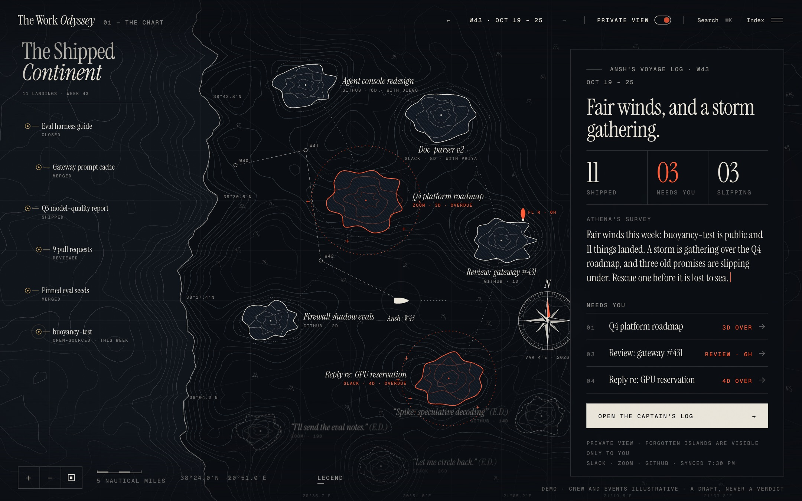
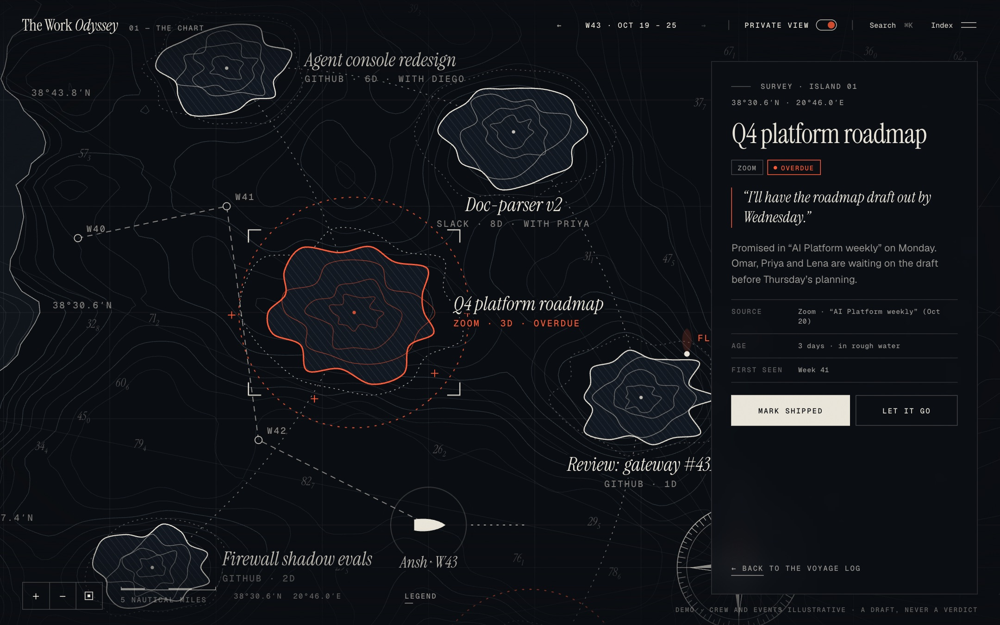
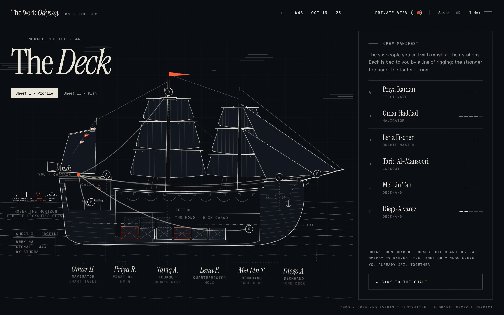
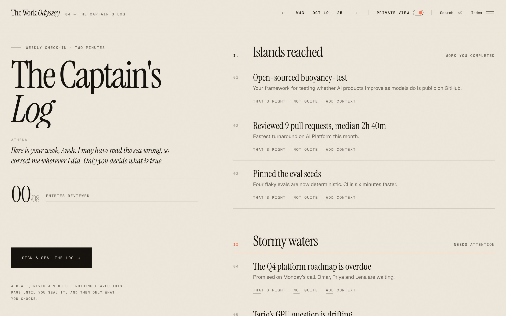
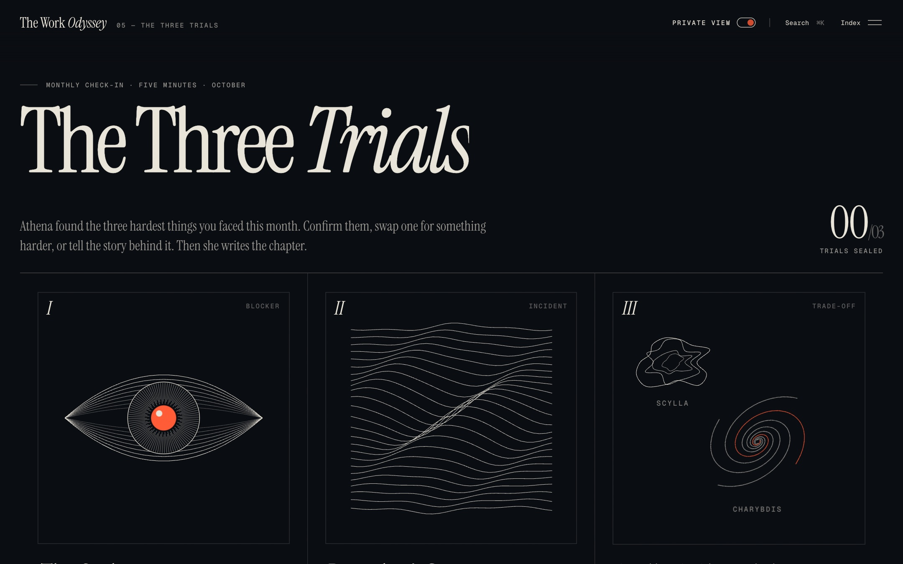
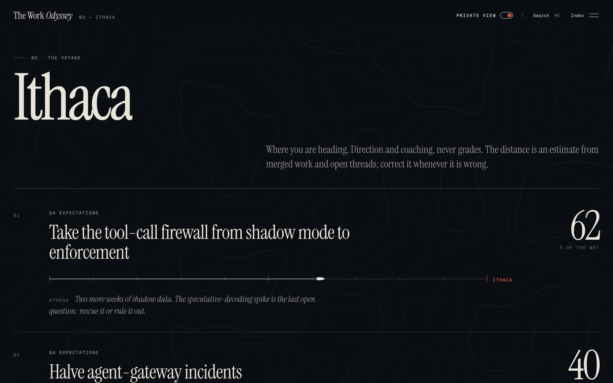
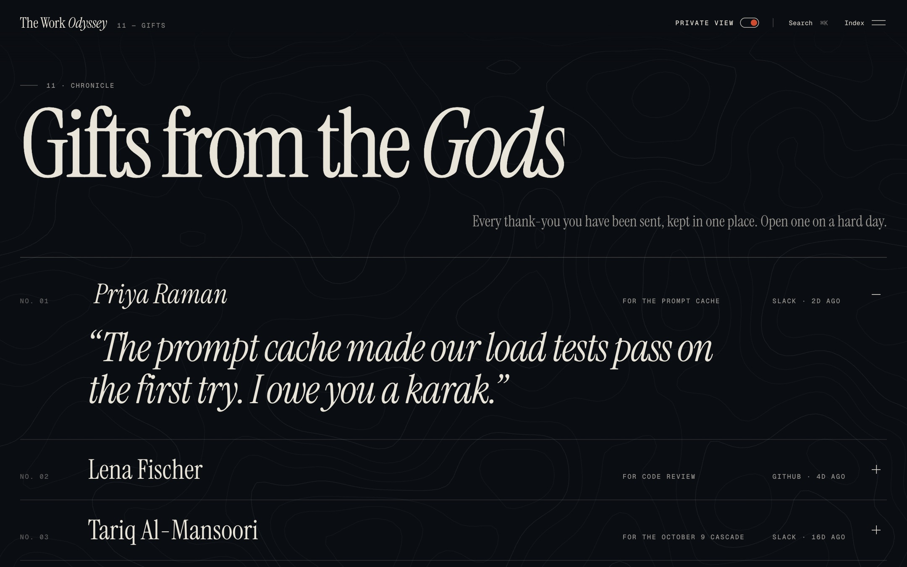
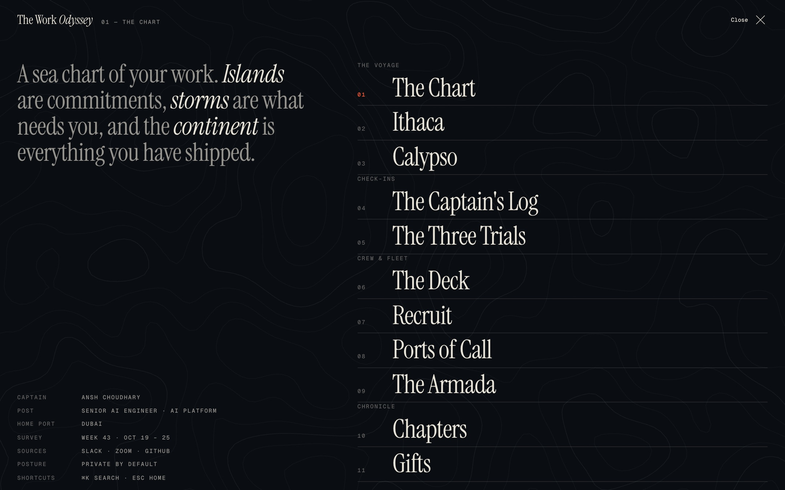

# The Work Odyssey

A performance and appraisal experience where your work is a sea chart. Islands are what you are carrying, storms are what needs you, and the continent is everything you have shipped. An AI guide, Athena, drafts the chart from Slack, Zoom and GitHub. You correct it. It is a draft, never a verdict.

**Live demo:** [anshchoudhary.github.io/the-odyssey](https://anshchoudhary.github.io/the-odyssey/)



## Run it

```bash
npm install
npm run dev      # http://localhost:5173
npm run build    # type-check, then a production bundle in dist/
```

Pushes to `main` deploy to GitHub Pages through `.github/workflows/pages.yml`.

## The idea

Most performance tools are dashboards of scores. The Odyssey treats a working week as a voyage instead, and keeps three promises:

- **A mirror first, an appraisal input second.** Nothing on the chart is a grade. There are no rankings and no scores, only direction.
- **You are the captain.** Every summary is a draft. Confirm it, correct it, or add the context Athena missed. Corrections redraw the chart.
- **Private by default.** Forgotten promises are visible only to you. The manager lens shows outcomes, never the forgotten waters.

## The voyage

The demo follows **Ansh Choudhary, Senior AI Engineer** on an AI Platform team in Dubai, through week 43 (October 19 to 25).

### 01 · The Chart

The home view: an engraved night chart of the Ionian Sea, drawn as hairlines on ink with one signal red.

- **Islands** are commitments, drawn as contour rings. More rings mean more weight.
- **Danger areas** (red, dashed, with rocks) are overdue work or someone waiting on you.
- **E.D.**, the chart abbreviation for "existence doubtful", marks forgotten promises slipping under the sea. They are visible only in the private view.
- **A flashing light** (`FL R · 6h`) marks a review someone requested from you.
- **The Shipped Continent** on the left collects everything that landed, week by week.
- **The ship's track** shows where you have been. Step back through the weeks and the ship sails back along it.
- **The sea is alive.** Depth contours are traced live on a canvas from simplex noise, bend around each island, and settle back when an island is resolved.

Drag to pan, scroll to zoom, and click an island to survey it. From the panel you can mark it shipped, rescue it or let it go.



### 06 · The Deck

Click the ship to board. Sheet I is an inboard profile of a three-masted ship, cut away to show who works where:

- **The crew stands at their stations:** First Mate at the helm, Navigator at the chart table, Quartermaster in the hold, Lookout in the crow's nest, and two Deckhands at the bow.
- **Bonds are rigging.** A line runs from you to each person, and the stronger the bond, the tauter it runs. Hover someone and their line pulls taut and turns red.
- **The hold carries your open work as cargo.** Overdue crates are red, and forgotten ones sit half under the water at the bottom of the hold. Click a crate to fly to its island.
- **The lookout's glass.** Hover the horizon to see what is coming: a storm, a review waiting, Ithaca in the distance.

Sheet II is the same crew as a top-down deck plan.



### 04 · The Captain's Log (weekly, about two minutes)

Athena's summary of your week on paper: islands reached, stormy waters, and promises slipping under. Each entry can be confirmed, amended or given context. Amendments redraw the chart. Sign and seal it when you are done.



### 05 · The Three Trials (monthly, about five minutes)

The month's three hardest problems, shown as engraved plates:

- **The Cyclops** is a blocker, a single point of failure. Its eye follows your cursor.
- **Poseidon's Storm** is an incident.
- **Scylla and Charybdis** is a trade-off with no good choice.

Confirm each trial, swap it for a harder one, or add the backstory. Athena then writes the month as an epic chapter, which you can keep private or share.



### Everything else

| | View | What it is |
|---|---|---|
| 02 | **Ithaca** | Goals as a passage toward Ithaca, with coaching instead of grades. |
| 03 | **Calypso** | Work that has gone becalmed. Set sail, ask the crew, or let it go. |
| 07 | **Recruit** | People whose work overlaps yours but who you rarely work with. |
| 08 | **Ports of Call** | Cross-team projects, and who is docked there. |
| 09 | **The Armada** | Teams as fleets, for managers: ships sailing alone, crews riding low under heavy load. Outcomes only. |
| 10 | **Chapters** | Each month as editable prose. |
| 11 | **Gifts** | Every thank-you, kept in one place. |

<p>
  
  
</p>

`Index` opens a full-screen table of contents. `⌘K` opens search, and `Esc` returns you to the chart.



## About the demo data

The captain is based on Ansh Choudhary's public GitHub. `buoyancy-test`, the tool-call firewall, the ARC-AGI-3 harness, `cuda-starter` and `Football-Tracking` all appear in the story. The crew, conversations, incidents and other teams are invented to make the voyage feel lived-in, and the UI labels them as illustrative. Everything lives in [`src/data.ts`](src/data.ts), so swapping in another person's voyage is a single-file change.

## Built with

- **Vite, React 18 and TypeScript (strict).** Zustand holds state, and routing uses hash routes such as `#/map` and `#/deck`.
- **Framer Motion** drives the transitions: the curtain between views, the letter-by-letter reveals, and the spring on the rigging lines.
- **Hand-built SVG** for the chart, the ship and the trial plates. Hairlines use `vector-effect: non-scaling-stroke` so they stay crisp at any zoom.
- **A canvas bathymetry layer.** Simplex noise is traced into contours with marching squares. Island bumps and the coastline shape the field, and it is redrawn with the chart's spring camera.
- **Type:** Instrument Serif for display, Geist for text, Geist Mono for chart labels.

```
src/
├── App.tsx              view registry, curtain transition, global keys
├── data.ts              the voyage: person, islands, crew, log, trials, fleets
├── store.ts             Zustand store and derived helpers
├── lib.ts               noise, contours, coastlines, coordinates, hooks
├── styles.css           design tokens and shared components
├── components/          HUD, index menu, intro, tour, legend, search, toasts, cursor, contour field
└── views/
    ├── MapView.tsx      the chart, camera and survey panel
    ├── DeckView.tsx     the deck shell and Sheet II (plan)
    ├── DeckProfile.tsx  Sheet I (inboard profile)
    ├── Rituals.tsx      the Captain's Log and the Three Trials
    └── Pages.tsx        Ithaca, Calypso, Chapters, Gifts, Armada, Recruit, Ports
```

The original single-file prototype is kept in [`prototype/index.html`](prototype/index.html).

## Roadmap

- **Live sources:** Slack threads, Zoom calls and attendance, GitHub pull requests, reviews and issues, and calendar patterns.
- **Collaboration graph:** bond strength weighted by how often, how recently and how you work with someone.
- **Athena:** weekly drafts, storm warnings for at-risk commitments, and rescue or let-go suggestions.
- **Review workflow:** a way to bring sealed logs and shared chapters into formal reviews without the private waters.

## License

MIT. See [LICENSE](LICENSE).
