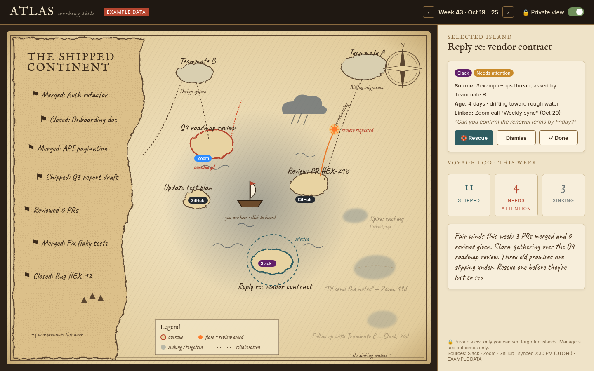
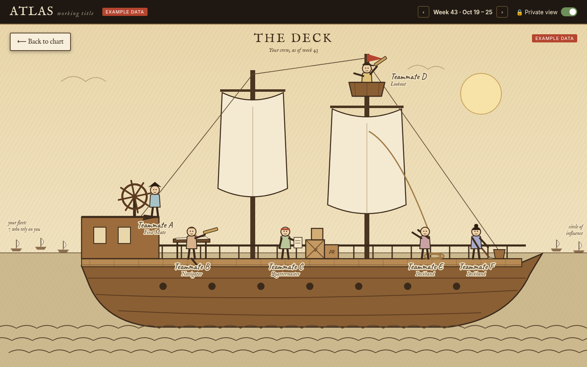
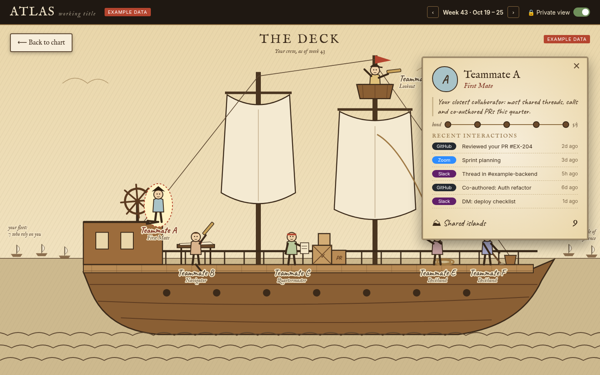
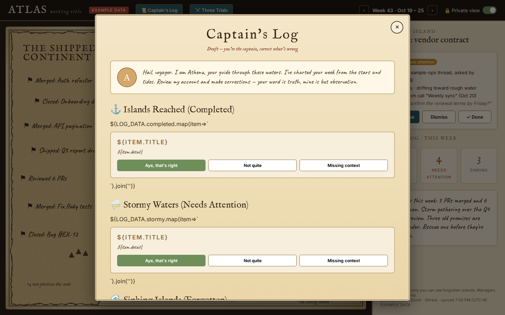
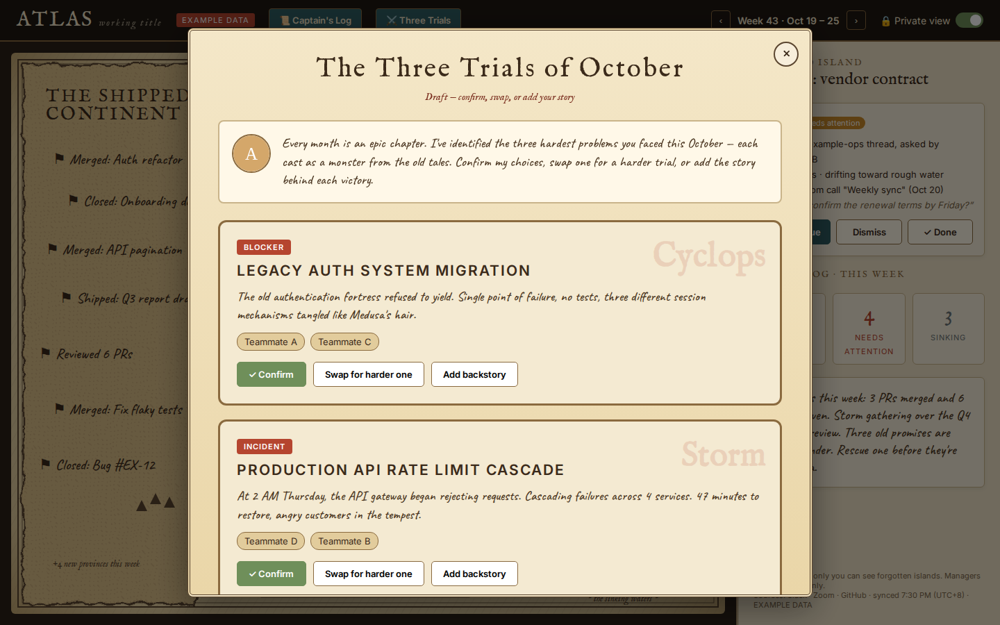

# The Work Odyssey

An AI-run HR performance & appraisal experience where every employee's work is visualized as a voyage on a hand-drawn old sea chart.



## Concept

The Work Odyssey reimagines performance tracking and HR appraisals through a narrative, visual interface inspired by ancient maritime charts. Instead of sterile dashboards and cold metrics, employees see their work as an evolving journey across a living sea map.

### The Map as Mirror

**Islands** represent tasks and commitments:
- Active islands: current work in progress
- Stormy waters near your ship: work that needs immediate attention
- Sinking, faded islands: forgotten commitments you can rescue or dismiss
- **The Shipped Continent**: your completed work, growing with each achievement

**Your Ship** is positioned on the map based on your current focus. Click the ship to zoom into the deck.



**The Crew** represents your close collaborators, visible when you board your ship:
- **First Mate**: your closest collaborator (most shared threads, calls, co-authored work)
- **Navigator**: the person you go to for direction
- **Quartermaster**: checks your cargo (frequent PR reviewer)
- **Lookout**: spots trouble early (flags incidents and bugs)
- **Deckhands**: wider circle of regular collaborators

Each crew member shows their role, bond strength (1-5), and recent interactions.



**The Distant Fleet**: your circle of influence—people who rely on you.

### Demo

Watch the full interaction flow:

https://github.com/user/repo/blob/main/assets/flow.mp4

*(Or download and view [assets/flow.mp4](assets/flow.mp4) directly)*

## Features

### Current Prototype (Single-file HTML)

✅ **Interactive hand-drawn sea chart** with animated elements  
✅ **Island states**: active, overdue (red border + storm), and sinking/forgotten (faded with blur)  
✅ **Ship click-to-zoom** transition into the deck view  
✅ **Animated crew members** with unique appearance, roles, and personalities  
✅ **Crew detail cards** showing bond strength and recent interactions  
✅ **Week navigation** to explore historical voyage data  
✅ **Privacy toggle** (🔒 Private view) to hide/show forgotten work  
✅ **Voyage log** with natural-language weekly summary  
✅ **Stats dashboard**: Shipped, Needs Attention, Sinking counts  
✅ **Legend** explaining map symbols and visual language  
✅ **Source tags** (Slack, Zoom, GitHub) linking work to its origin  
✅ **Compass rose** and period-appropriate typography  
✅ **Example data** clearly marked throughout

### ✨ AI Check-In Features

#### 📜 Weekly Captain's Log (~2 minutes)



A scroll delivered by **Athena** (your AI guide) summarizing your week:
- **Islands Reached** (completed work)
- **Stormy Waters** (needs attention)
- **Sinking Islands** (forgotten commitments — private by default)

**Interactive Corrections:**
- **"Aye, that's right"** — Confirm the AI got it right
- **"Not quite"** — Inline edit to correct the details
- **"Missing context"** — Add a one-line note about what the AI missed

**Horizon View:**
- **Ithaca** (Q4 expectations) shown as destination with progress bar and coaching
- **The Sirens** (distractions) — e.g., "8 hours in meetings slowed your API migration"
- **Crew Gifts** (Slack kudos from teammates)

Corrections visibly update the map. **"Draft — you're the captain"** label reinforces that this is your truth, not an evaluation.

#### ⚔️ Monthly Three Trials (~5 minutes)



The month as an epic chapter. AI identifies your 3 hardest problems as monsters:
- **🦹 The Cyclops** = blocker (single point of failure)
- **⚡ Poseidon's Storm** = incident (production fire, cascade failure)
- **⚓ Scylla & Charybdis** = trade-off (no good choice, pick the least bad)

**Per Trial:**
- **Confirm** — AI got it right
- **Swap for a harder one** — Add your own challenge
- **Add backstory** — Why was this hard? Who helped? What would you do differently?

**Epic Rendering:**
After you've confirmed or edited all three trials, the AI renders your month as mock-epic prose incorporating your words:

> *"In the waning days of October, you faced three trials... First came The Cyclops, guardian of the legacy fortress. Spent 3 weeks untangling session logic. Teammate A pair-programmed the critical refactor..."*

**Privacy:** Corrections private by default. You choose what to share with your manager.

### Check-In Philosophy

🎯 **Draft, not verdict** — Check-ins are collaborative corrections, not performance reviews  
🎮 **Feels like play** — Swapping monsters, writing epic backstories, correcting Athena's observations  
🏷️ **Labeled data** — Your corrections teach the AI what "hard" means to you, improving future summaries  
📊 **No scores or rankings** — Direction and coaching, never grades  
🔒 **Privacy-first** — Forgotten work and backstory edits are private unless you choose to share  

### Privacy Principles

🔒 **The map is a mirror first, appraisal input second.**
- Forgotten/sinking islands are **private by default** and visible only to the employee
- Managers see outcomes and shipped work, not the forgotten waters
- **Never score from the sea alone**: performance is contextual, not purely metric-based

🛡️ **Transparency in data sources:**
- All data sources are labeled (Slack, Zoom, GitHub)
- Sync timestamp clearly displayed
- EXAMPLE DATA badge shown in prototype

## Data Source Roadmap

### Phase 1: Foundation (Current Prototype)
- ✅ Static example data
- ✅ Visual design system
- ✅ Interaction patterns

### Phase 2: Live Integrations (Future)
- [ ] **Slack**: threads, DMs, reactions, mentions
- [ ] **Zoom**: meeting attendance, duration, participant lists
- [ ] **GitHub**: PRs, reviews, commits, issues
- [ ] **Calendar**: meeting patterns, time blocking

### Phase 3: Collaboration Graphs (Future)
- [ ] Circle of influence mapping
- [ ] Bond strength algorithm (weighted by interaction frequency, recency, and type)
- [ ] Team network visualization

### Phase 4: AI Intelligence Layer (Future)
- [ ] Natural language voyage logs (weekly summaries)
- [ ] Sentiment analysis from communication patterns
- [ ] Proactive "storm warnings" for at-risk commitments
- [ ] Smart rescue/dismiss suggestions

## How to Run

**Just open `index.html` in a modern web browser.** No build process, no dependencies, no server required.

```bash
# Clone the repository
git clone https://github.com/user/repo.git
cd repo

# Open in your browser
open index.html  # macOS
xdg-open index.html  # Linux
start index.html  # Windows
```

Or simply double-click `index.html` in your file explorer.

Works best in:
- Chrome/Edge (latest)
- Firefox (latest)
- Safari (latest)

## Technical Details

- **Single-file prototype**: All HTML, CSS, and JavaScript in `index.html`
- **No frameworks**: Vanilla JavaScript for maximum portability
- **SVG-based graphics**: Hand-drawn aesthetic with filters and animations
- **Web fonts**: IM Fell English (nautical headings), Caveat (handwritten labels), Inter (UI)
- **Responsive**: Designed for 1440×900 viewport (desktop-first)

## Buoyancy Note: The Hull

This prototype is the **aesthetic and interaction layer**—the sails catching wind. The hull (data infrastructure) needs:

1. **Company-owned data pipeline**: Slack/Zoom/GitHub API integrations
2. **Review workflow embedding**: How managers use odyssey data in formal reviews
3. **Low scaffolding**: intentionally narrative-driven, not metric-obsessed

The Work Odyssey is designed to be embedded into existing HR systems, not to replace them. Think of it as a **humanizing layer** on top of performance data.

## File Structure

```
/
├── index.html                    # The complete working prototype
├── assets/
│   ├── mockup.png               # Main map view screenshot
│   ├── deck.png                 # Deck view screenshot
│   ├── deck-card.png            # Crew detail card screenshot
│   ├── captains-log.png         # Weekly Captain's Log check-in
│   ├── three-trials.png         # Monthly Three Trials check-in
│   └── flow.mp4                 # Demo video of the interaction flow
├── README.md                    # This file
└── LICENSE                      # MIT License
```

## Contributing

This is a concept prototype. If you're interested in:
- Building out the data pipeline
- Integrating with real HR systems
- Expanding the visual language
- Adding accessibility features

Please open an issue to discuss!

## License

MIT License - See [LICENSE](LICENSE) file for details.

---

**The Work Odyssey**: Where work is a journey, not a grind.  
*All data shown is EXAMPLE DATA for demonstration purposes.*
